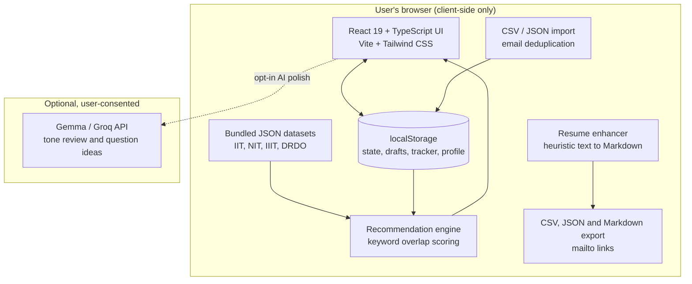
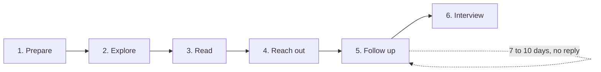
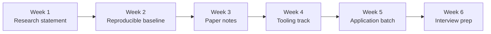
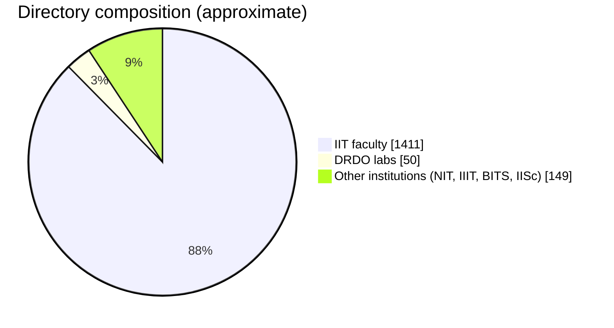

<h1 align="center">WRID: Winter Research Internship Desk</h1>

<p align="center">
  <b>Your winter research internship starts before the first email.</b><br/>
  A calm, rigorous workspace for undergraduates applying to winter research internships across IITs, NITs, IIITs, DRDO labs and global fellowships.
</p>

<p align="center">
  <a href="https://hacktoberfest-winter-research.vercel.app"></a>
  
  
  
  
  
</p>

<p align="center">
  
</p>

---

## Table of contents

1. [Why WRID](#why-wrid)
2. [Feature tour](#feature-tour)
3. [Architecture](#architecture)
4. [Application roadmap](#application-roadmap)
5. [6-week preparation plan](#6-week-preparation-plan)
6. [Data sources](#data-sources)
7. [Getting started](#getting-started)
8. [Configuration](#configuration)
9. [Project structure](#project-structure)
10. [Privacy and limitations](#privacy-and-limitations)
11. [Contributing](#contributing)
12. [License](#license)

---

## Why WRID

Winter research internships are competitive and scattered. Each institution has its own process, deadlines and etiquette, and students end up tracking everything across notes, tabs and spreadsheets. WRID brings preparation, outreach and tracking into one private, browser-based workspace built for students across disciplines: Computer Science, AI/ML, Electrical & Electronics, Mechanical Engineering, Chemistry, Physics, Life Sciences, Mathematics and Interdisciplinary Studies.

---

## Feature tour

| # | Module | What it does |
|---|--------|--------------|
| 1 | **Start Here** | Onboarding, a personalized plan builder, and honest progress metrics |
| 2 | **Faculty Directory** | 1,610+ verified professors across 49 institutions, with filters, relevance reasons and a detail drawer |
| 3 | **DRDO Directory** | All 50 labs, autonomous societies and test ranges, with an application-route checklist |
| 4 | **Email Studio** | 5 academic templates, placeholder detection, `mailto:` launcher, and optional AI tone review |
| 5 | **Opportunities** | Curated global fellowships with stipends, deadlines, eligibility and direct portal links |
| 6 | **Resume Autopilot** | Parses your resume, then ranks matching faculty and fellowships |
| 7 | **My Applications** | 9-stage tracker with follow-up reminders and CSV/JSON backup |
| 8 | **Prep Roadmap** | 6 weeks of checkable milestones, discipline-specific tooling and a paper-notes scratchpad |
| 9 | **Resources** | Guides on academic CVs, reproducible READMEs, 3-pass paper reading, and interview prep |

### Screenshots

<table>
  <tr>
    <td align="center"><br/><sub><b>Faculty Directory</b>: multi-factor filters and relevance reasons</sub></td>
    <td align="center"><br/><sub><b>Email Studio</b>: live preview and placeholder detection</sub></td>
  </tr>
  <tr>
    <td align="center"><br/><sub><b>My Applications</b>: status pipeline and follow-up flags</sub></td>
    <td align="center"><br/><sub><b>Resume Autopilot</b>: ranked faculty and fellowship matches</sub></td>
  </tr>
</table>

> Screenshots live in `docs/screenshots/`. Replace the placeholders with real captures before publishing.

---

## Architecture

WRID is a client-side application. Your data stays in your browser unless you opt in to an external AI call.



### Key design decisions

- **Privacy first:** no backend, no accounts. Everything persists in `localStorage`.
- **Transparent ranking:** every match shows its reason (keyword overlap and verified papers), so students can judge the result rather than trust a score.
- **Zero-key core:** the full app works without any API key. AI is an enhancement, never a requirement.

---

## Application roadmap

The six stages every application follows:



Tracker statuses: **Shortlisted → Reading their work → Draft ready → Applied → Follow-up sent → Replied → Interview → Offer → Closed**.

---

## 6-week preparation plan



The plan includes 22 milestones and four discipline-specific tracks: **AI/Data Science**, **Systems/Networking**, **Electronics/Robotics** and **Experimental Sciences**.

---

## Data sources

| Dataset | File | Records | Status |
|---------|------|---------|--------|
| IIT faculty | `src/data/iitFaculty.json` | 1,411 | Public compilation from IITs, tagged as directory-listed |
| NIT / IIIT / BITS / IISc faculty | `src/data/nitFaculty.json`, `iiitFaculty.json` | Part of the 1,610 total | Same verification tags as above |
| DRDO labs | `src/data/drdoLabs.json` | 50 | Imported from a community list, all marked unverified |
| Email templates | `src/data/emailTemplates.ts` | 5 | Deterministic parameter rendering |
| Roadmap | `src/data/roadmapData.ts` | 6 weeks, 22 milestones | Curated |
| Guides | `src/data/resourcesData.ts` | 6 guides | Curated |



> The "Other institutions" slice is the remainder of the 1,610 total, calculated for display. Verify exact counts against the JSON files.

---

## Getting started

### Prerequisites

- Node.js **18+** (tested on Node 26)
- npm **9+**

### Install and run

```bash
git clone https://github.com/<your-username>/wrid.git
cd wrid
npm install
npm run dev
```

Open <http://localhost:5173>.

### Production build

```bash
npm run build
npm run preview
```

---

## Configuration

AI polish is optional. Create a `.env` file only if you want it:

```bash
# Google AI Studio key (starts with AIza...)
VITE_GEMMA_API_KEY=your_gemma_api_key_here

# Groq key (starts with gsk_...)
VITE_GROQ_API_KEY=your_groq_api_key_here
```

> **Security note:** Any variable prefixed with `VITE_` is bundled into client-side JavaScript and is visible to anyone who opens the site. Use keys with strict quotas, or route AI calls through a serverless proxy (for example, a Vercel Function) that holds the key server-side. Do not deploy with a high-value key in `VITE_` variables.

---

## Project structure

```
wrid/
├── src/
│   ├── components/     # UI: directories, Email Studio, tracker, roadmap
│   ├── data/           # Static JSON datasets and content modules
│   ├── engines/        # Recommendation and resume enhancer (client-side)
│   ├── hooks/          # localStorage-backed state
│   └── App.tsx
├── docs/screenshots/   # README images
└── package.json
```

> Adjust the folder names above to match the repository.

---

## Privacy and limitations

- **Independent project.** WRID is an open-source student tool. It is not affiliated with, endorsed by or sponsored by IITs, DRDO or the Ministry of Defence.
- **Unverified DRDO contacts.** The supplied director emails are administrative leadership, not internship coordinators. The app guides students to official circulars at `drdo.gov.in` or to a formal inquiry instead.
- **No background notifications.** Follow-up reminders appear when the user opens the site. Nothing is sent in the background.
- **Backups matter.** `localStorage` can be cleared by the browser. Export a JSON backup from the header regularly.
- **Mail attachments are manual.** The `mailto:` launcher cannot attach files. Add your CV yourself.

---

## Contributing

Contributions are welcome, especially during Hacktoberfest.

1. Fork the repo and create a branch: `git checkout -b feat/your-idea`
2. Make your change and run `npm run build` to confirm it compiles
3. Commit using Conventional Commits, for example `feat: add DRDO filter`
4. Open a pull request describing the problem and the fix

**Good first issues:** adding verified faculty records, improving keyword synonyms in the recommendation engine, and writing additional guides.

Please don't add personal data about real people without a public source, and cite where each record came from.

---

## License

License to be confirmed by the maintainer. Add a `LICENSE` file before accepting outside contributions.

---

<p align="center">
  Built for students who want their research internship to start before the first email. <br/>
  <sub>If WRID helped you, a star on the repo helps other students find it.</sub>
</p>
